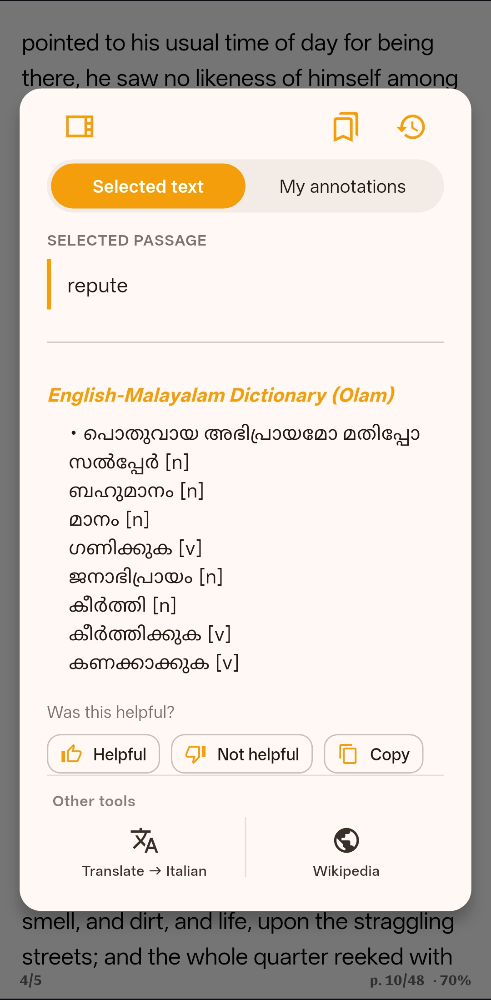

## English to Malayalam Dictionary for CaliMob

An English–Malayalam offline dictionary for CaliMob ebook reader. Download the ready-to-import dictionary ZIP and look up Malayalam meanings while reading English ebooks on Android.

This project makes an English-to-Malayalam dictionary available to CaliMob users by packaging dictionary data in the StarDict format supported by its dictionary importer.

📥 Download the Dictionary

"Download English–Malayalam Dictionary ZIP" (https://github.com/melvinvarghese/English-to-Malayalam-Dictionary-for-Calimob/raw/refs/heads/main/English-to-Malayalam-Calimob-Dictionary_melvinvarghee.in.zip)

The archive is hosted on GitHub and can be downloaded directly to your device.

✨ Features

- English to Malayalam translation: Look up English words and find their Malayalam meanings.
- CaliMob compatibility: Packaged for import through CaliMob's custom dictionary URL feature.
- Offline lookup: Access dictionary entries offline after successfully installing the dictionary.
- StarDict format: Includes the dictionary files required by the StarDict format.
- Open-source availability: Publicly available for readers and developers to access and evaluate.
- Free download: Download the dictionary archive directly from GitHub.

📱 How to Install the Dictionary in CaliMob

Follow these steps to add the English–Malayalam dictionary to CaliMob.

1. Open the "CaliMob English–Malayalam dictionary ZIP" (https://github.com/melvinvarghese/English-to-Malayalam-Dictionary-for-Calimob/raw/refs/heads/main/English-to-Malayalam-Calimob-Dictionary_melvinvarghee.in.zip) link.

2. Open CaliMob on your Android or iOS device.

3. Navigate to Dictionaries.

4. Find the Custom URL field.

5. Paste the direct download URL below into the field.
   
   https://github.com/melvinvarghese/English-to-Malayalam-Dictionary-for-Calimob/raw/refs/heads/main/English-to-Malayalam-Calimob-Dictionary_melvinvarghee.in.zip

6. Tap the download icon and wait for the dictionary to install.

7. Open an English ebook and test the dictionary lookup feature.

Important: Use the direct download URL ending in ".zip", not the GitHub "/blob/" webpage URL.

📚 Dictionary Source and Attribution

The dictionary data is derived from the "Olam English–Malayalam Dictionary" (https://olam.in/p/open/enml), an open English–Malayalam lexical resource.

Olam's published dataset is distributed under the Open Database License (ODbL). Users who redistribute this dictionary should consult the original licence and comply with its attribution, share-alike, and other applicable requirements.

- Original project: "Olam" (https://olam.in/)
- Original dataset: "English–Malayalam Dictionary" (https://olam.in/p/open/enml)
- Dataset licence: "Open Database License (ODbL)" (https://opendatacommons.org/licenses/odbl/)

This repository provides a CaliMob-oriented distribution of the dictionary data. Please consult the original source for dataset updates, licensing terms, and additional information.

🛠️ Technical Details

The dictionary archive uses the StarDict dictionary format.

A typical StarDict dictionary contains these files:

- ".ifo" — dictionary metadata
- ".idx" — word index
- ".dict" or ".dict.dz" — dictionary definitions

These files must be packaged correctly for the target application to recognise and import the dictionary.

🎯 Who Is This For?

This dictionary is intended for:

- Malayalam speakers reading English ebooks in CaliMob.
- Readers who want English word meanings in Malayalam while reading.
- Students and language learners looking for English–Malayalam vocabulary support.
- Users who prefer offline dictionary access.
- CaliMob users looking for a Malayalam dictionary that is not listed among the available FreeDict dictionaries.

🤝 Contributing

Contributions and feedback are welcome.

You can help by:

- Reporting installation or dictionary lookup problems.
- Suggesting improvements to dictionary entries.
- Reporting incorrect or missing meanings.
- Helping improve documentation and compatibility.
- Contributing reproducible conversion tools and dataset updates.

Please ensure that any redistributed dictionary data complies with the applicable source licence.

📄 Licence

The underlying Olam dictionary dataset is published under the "Open Database License (ODbL)" (https://opendatacommons.org/licenses/odbl/).

Please refer to the original dataset's licence and attribution requirements before redistributing modified or derived dictionary data. The licensing of any conversion scripts or other original files should be specified separately.

🔗 Related Links

- Dictionary download: "Download ZIP" (https://github.com/melvinvarghese/English-to-Malayalam-Dictionary-for-Calimob/raw/refs/heads/main/English-to-Malayalam-Calimob-Dictionary_melvinvarghee.in.zip)
- Original dictionary: "Olam English–Malayalam Dictionary" (https://olam.in/p/open/enml)
- Dataset licence: "ODbL" (https://opendatacommons.org/licenses/odbl/)
- CaliMob: "Official website" (https://caliwebapp.com/en)

---

If this dictionary helps with English ebook reading in Malayalam, consider starring this repository and sharing it with other CaliMob users.

Keywords: English to Malayalam dictionary, Malayalam dictionary download, CaliMob dictionary, CaliMob offline dictionary, English Malayalam translation, StarDict English Malayalam, Malayalam ebook reader dictionary.
