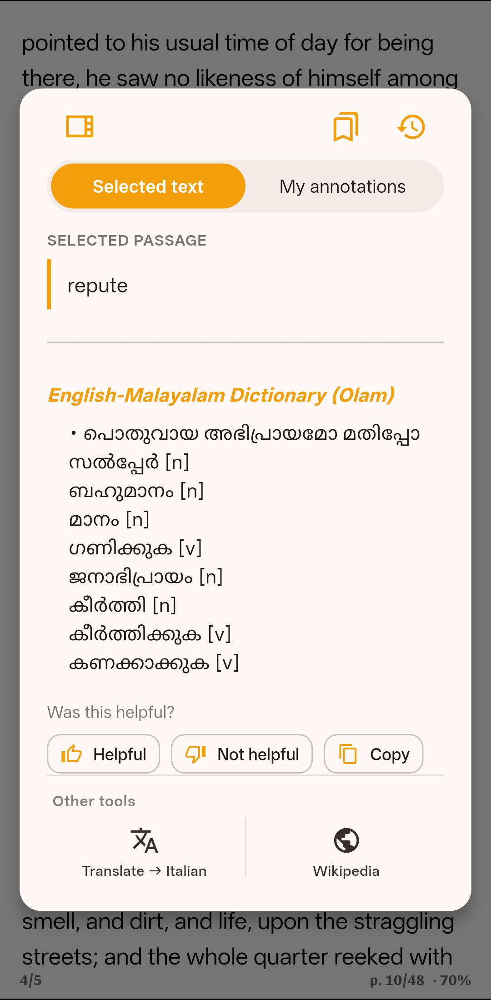

# English–Malayalam Dictionary for CaliMob

An offline English–Malayalam dictionary for the [CaliMob](https://caliwebapp.com/en) ebook reader. Add it to CaliMob and look up Malayalam meanings of English words while you read.



## Download

[Download the dictionary ZIP](https://github.com/melvinvarghese/English-to-Malayalam-Dictionary-for-Calimob/raw/refs/heads/main/English-to-Malayalam-Calimob-Dictionary_melvinvarghese.in.zip)

The dictionary is in StarDict format, which CaliMob's custom dictionary option can import.

## How to install it in CaliMob

1. Open CaliMob and go to **Dictionaries**.
2. Find the **Custom URL** field.
3. Paste this link into it:

   ```
   https://github.com/melvinvarghese/English-to-Malayalam-Dictionary-for-Calimob/raw/refs/heads/main/English-to-Malayalam-Calimob-Dictionary_melvinvarghese.in.zip
   ```

4. Tap the download icon and wait for the dictionary to install.
5. Open an English ebook and look up a word to check that it works.

Use the direct link ending in `.zip` shown above. The normal GitHub page link (the one with `/blob/` in it) will not work.

Once installed, the dictionary works offline.

## Source and licence

The entries come from the [Olam English–Malayalam dictionary](https://olam.in/p/open/enml), which is published under the [Open Database License (ODbL)](https://opendatacommons.org/licenses/odbl/). If you share or reuse this dictionary, follow that licence, including crediting Olam and sharing under the same terms.

## What's in the ZIP

A StarDict dictionary is made of three kinds of file:

- `.ifo`: dictionary details
- `.idx`: word index
- `.dict` or `.dict.dz`: the meanings

## Feedback

If a word is missing, a meaning is wrong, or the dictionary won't install, please [open an issue](https://github.com/melvinvarghese/English-to-Malayalam-Dictionary-for-Calimob/issues).
